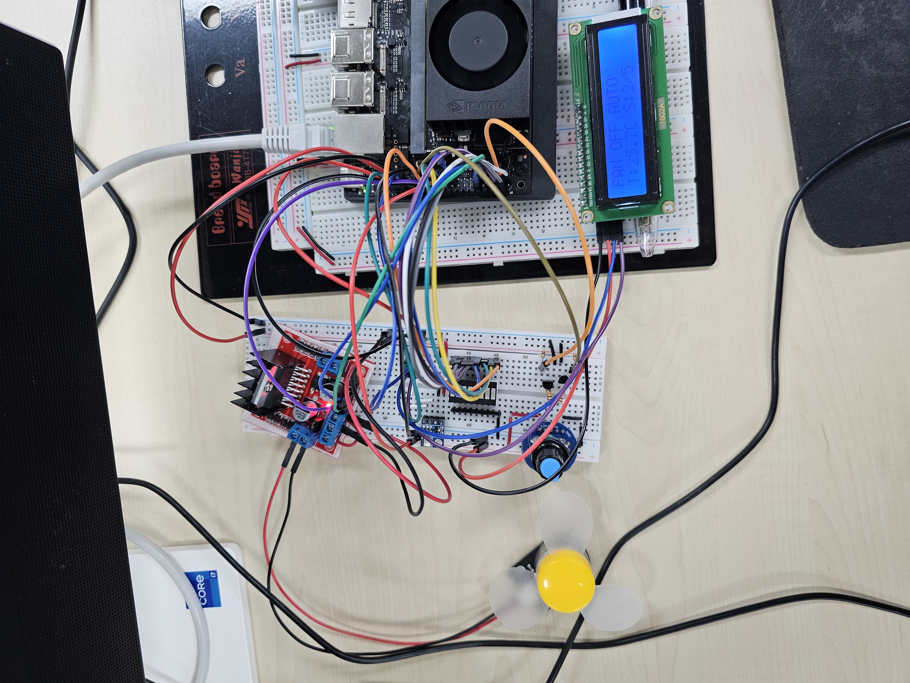
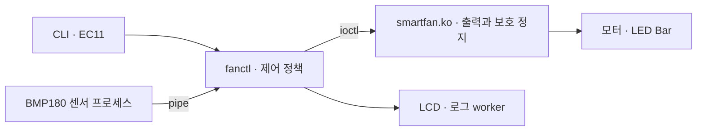

# Jetson Smart Fan Controller

**모터 제어부터 장애 시 정지까지, Linux Kernel Driver와 C로 구현한 스마트 선풍기입니다.**

`C11` · `Linux 5.15` · `Jetson Orin Nano` · `GPIO / PWM / I²C` · `Process / Thread`

<p align="center">
  <a href="docs/assets/hardware-overview.jpg"></a>
</p>

**[시연 영상 보기](docs/assets/demo.mp4)** · [배선·표시 사진](docs/hardware.md)

## 어떤 동작을 하나요?

- **수동 제어:** EC11 엔코더로 풍속 0~5단계 선택, LED Bar·LCD 연동
- **자동 제어:** BMP180 온도로 목표 풍속 결정, hysteresis로 경계 진동 억제
- **보호 정지:** heartbeat 중단 시 lease 2초, 연속 구동 30초 제한
- **장애 대응:** 센서 오류·데이터 만료 시 AUTO 정지, 복구 후 명시적 ON 요구

## 어떻게 설계했나요?



| 설계 선택                               | 해결한 문제                                          |
| --------------------------------------- | ---------------------------------------------------- |
| Kernel이 GPIO/PWM 출력과 정지 정책 소유 | 애플리케이션 중단에 대한 보호를 사용자 루프에서 분리 |
| 센서 process + LCD/log thread           | Blocking I²C·파일 기록을 heartbeat 경로에서 분리     |
| AUTO 갱신을 kernel mutex 안에서 검증    | 상태 조회와 기동 사이의 보호 정지 경쟁 조건 방지     |

직접 구현한 driver는 기존 Linux GPIO/PWM provider를 재사용합니다. [설계 상세](docs/architecture.md) · [문제 해결 사례](docs/development.md)

## 어디까지 확인했나요?

| 구분       | 확인 내용                                                                                 |
| ---------- | ----------------------------------------------------------------------------------------- |
| 실물       | 모터·엔코더·LED·센서·LCD 문자 표시, AUTO 정지/복구, lease·30초 제한·Ctrl+C 정지 확인 보고 |
| 소프트웨어 | C 테스트 11개, CLI 37개, 정리/DT 제안 6개, GCC analyzer·ASan/UBSan·ThreadSanitizer 통과   |

실물 확인은 기존 통합 동작 기준입니다. 최종 종료 경로 수정 후 재확인과 LCD 대비·전원 전류 여유·RPM/발열·실제 suspend 측정은 남아 있습니다. [검증 범위](docs/review.md)

## 직접 실행하려면

검증 장비: Ubuntu 22.04 · L4T 36.5.2 · kernel 5.15.199-tegra · GCC 11.4.0.

```sh
make all
make test
./build/fanctl --dry-run --encoder --bmp180 --lcd
```

Dry-run은 하드웨어에 접근하지 않습니다. 실제 장비는 DT와 배선 설정이 필요합니다. [실행·명령](docs/build-run.md) · [하드웨어](docs/hardware.md) · [통합 테스트](docs/final-test.md)

<details>
<summary>소스에서 확인할 부분</summary>

| 경로                                      | 역할                                   |
| ----------------------------------------- | -------------------------------------- |
| [driver/](driver/) · [include/](include/) | platform driver · 고정 폭 ioctl UAPI   |
| [app/](app/)                              | 제어 정책 · 센서 IPC · LCD/로그 동기화 |
| [dts/](dts/) · [scripts/](scripts/)       | pinmux · DT 준비/설치 검증             |
| [tests/](tests/)                          | 정상 동작·장애·경쟁 조건·종료 회귀     |

</details>
