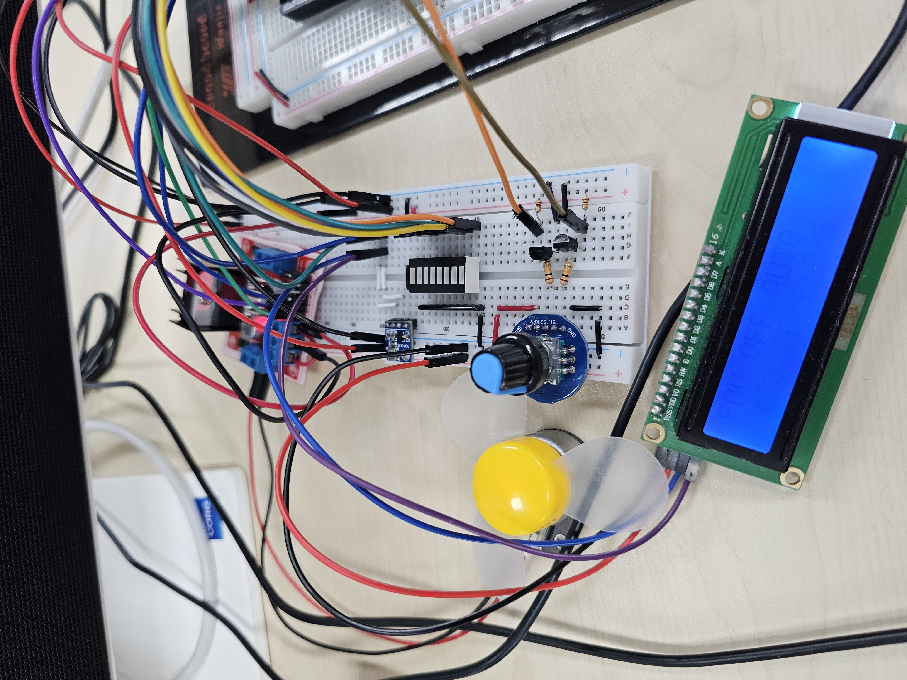
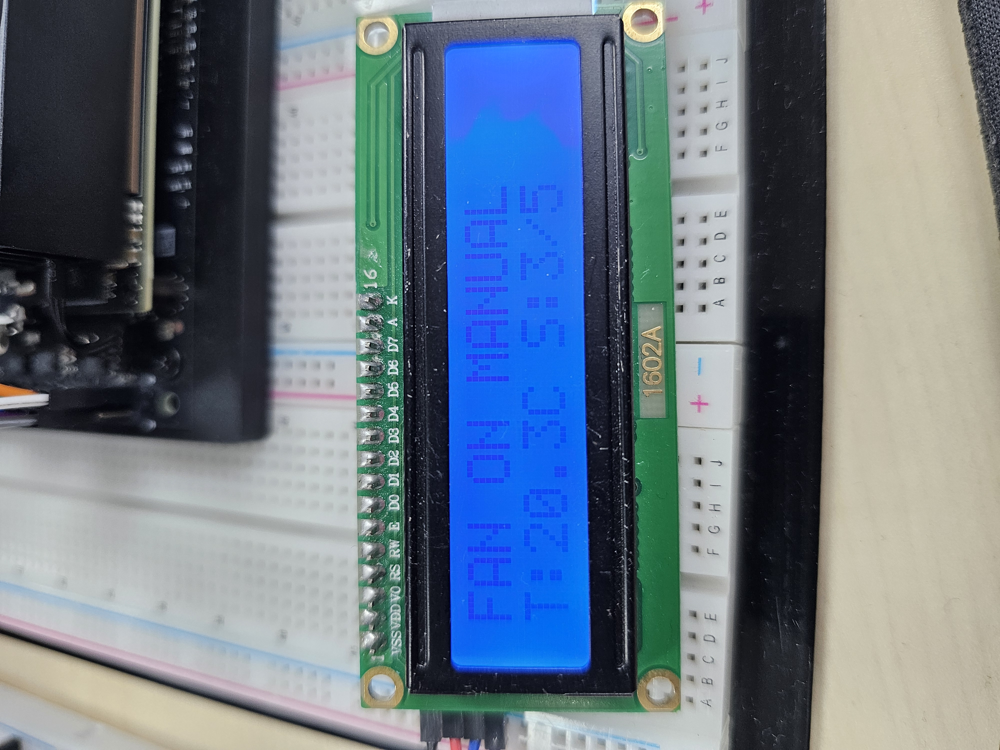
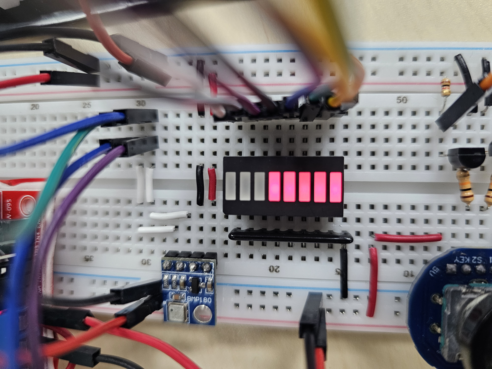

# 하드웨어

**현재 동작 확인된 배선입니다.** Jetson 번호는 J12 **물리 핀**이며 GPIO line과 다릅니다. 새로운 전원 구성을 지시하는 문서가 아닙니다.

## 연결

| Jetson / 공급원   | 연결 대상                      | 신호                           |
| ----------------- | ------------------------------ | ------------------------------ |
| 1 또는 17 / 3.3V  | BMP180 VIN, EC11 전원, LCD VCC | 현재 공급 전압                 |
| 6/9/14 등 GND     | 각 모듈·NPN·L298N GND          | 공통 기준                      |
| 3 / 5             | BMP180·LCD SDA / SCL           | I²C bus7, 100kHz               |
| 32                | L298N ENA                      | GPIO41 / PG.06                 |
| 15                | L298N IN1                      | PWM1 / PN.01                   |
| 29                | L298N IN2                      | GPIO105 / PQ.05, 고정 LOW      |
| 12 / 38           | S1 / S2용 NPN 컬렉터           | GPIO50 / PH.07, GPIO52 / PI.01 |
| 2 또는 4 / 5V     | L298N +12V 표기 단자(Vs)       | 현재 모터 전원 공급원          |
| L298N OUT1 / OUT2 | R300 모터 두 선                | A channel                      |

LED 1~8은 물리 **13·16·18·22·33·35·37·40**, GPIO line **122·126·125·123·43·53·124·51** 순서입니다. 기존 전류 제한 저항/network를 유지하며 겸용 SPI1은 DT에서 비활성화합니다.

ENA cap은 GPIO 제어 시 제거합니다. L298N의 +12V는 단자 표기이며 현재 12V 공급을 뜻하지 않습니다. +5V 단자는 regulator jumper에 따라 역할이 달라지므로 정상 동작한 기존 구성을 임의로 바꾸지 않습니다.

<details>
<summary>실제 제어 보드 배선 사진</summary>

<a href="assets/control-board-wiring.jpg"></a>

EC11 옆 두 NPN 회로와 센서·LED Bar의 배치를 볼 수 있습니다. 정확한 연결은 위 핀 표와 아래 회로도를 기준으로 확인합니다.

</details>

## 엔코더 입력

채널마다 같은 NPN 회로를 사용합니다. 기본 debounce 기간은 0이며 Gray cycle/누락 검사를 유지합니다.

```text
3.3V ── 1kΩ ──┬── Jetson 12(S1) 또는 38(S2)
               C
EC11 S1/S2 ─10kΩ─ B  NPN
               E
               └── GND
```

MPS2/222A 표기는 MPS2222A 후보이며 제조사·패키지 확인 없이 다른 2222의 pin 순서를 적용하지 않습니다. KEY는 미사용입니다. 두 채널의 동일 반전은 상대 위상을 뒤집지 않습니다.

## 실제 표시

| LCD 상태 표시                                                                                                                                                      | LED Bar 점등                                                                                                                  |
| ------------------------------------------------------------------------------------------------------------------------------------------------------------------ | ----------------------------------------------------------------------------------------------------------------------------- |
| <a href="assets/lcd-manual-status.jpg"></a> | <a href="assets/led-bar-output.jpg"></a> |
| 운전 상태·모드·온도·풍속 단계를 표시합니다.                                                                                                                        | 사진에서는 다섯 칸이 켜져 있습니다.                                                                                           |

각각 별도로 촬영한 표시 예시입니다. 사진을 누르면 원본을 볼 수 있습니다.

## 센서와 전원 한계

BMP180은 0x77/ID0x55, 온도·기압 센서입니다. LCD는 0x27, PCF8574 표준 mapping(RS0/RW1/E2/BL3/D4..7)으로 문자 표시를 확인했습니다.

LCD의 3.3V 대비 부족, Jetson 5V 모터 공급의 기동/정지 전류·전압 여유·발열은 미측정/미해결입니다. 5V I²C pull-up을 레벨 변환 없이 Jetson/BMP180에 연결하지 않습니다. 현재 기능 성공을 전원 설계의 정량 검증으로 확대하지 않습니다.

<details>
<summary>NPN 회로의 전기적 해석과 참고 자료</summary>

LOW0.2V 가정에서 1kΩ 분기는 약 3.1mA/9.6mW입니다. 이는 rail→저항→NPN→GND 전류이며 GPIO 공급 전류가 아닙니다. Base10kΩ/입력3.3V/VBE0.7V 가정의 전류는 약0.26mA이나 내부 저항에 따라 달라집니다. 실제 LOW를 확인해야 합니다.

TXB0108의 50kΩ은 보수적 권장 조건이며 작은 pull 저항의 조건부 허용을 모든 GPIO 부하에 일반화하지 않습니다. [TI TXB0108](https://www.ti.com/lit/ds/symlink/txb0108.pdf) · [onsemi MPS2222/A](https://www.onsemi.com/download/data-sheet/pdf/mps2222-d.pdf)

LOW0~0.4V/HIGH3.0~3.3V는 확인 여유 목표이며 datasheet 최소 threshold가 아닙니다. 전류 모드 멀티미터로 rail을 병렬 단락하지 않습니다.

</details>
