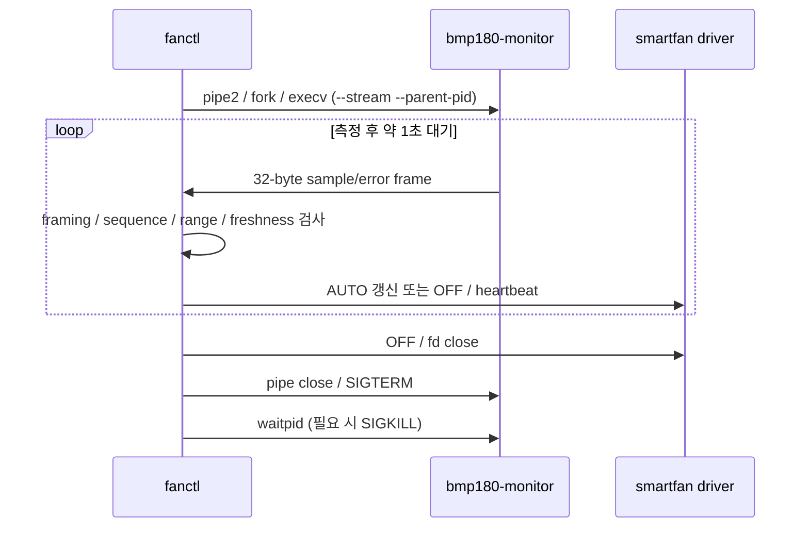

# 6단계: Multi-Process / IPC

## 역할과 설계 판단

기존 BMP180/AUTO 구현에 이미 포함된 프로세스 분리를 6단계 요구에 맞춰 재검토하고, 실제 프로세스 생성·정상 IPC·강제 종료·제어 일관성 테스트를 보강했습니다. 7단계의 신규 로깅 스레드는 추가하지 않았습니다. 기존 LCD worker는 유지합니다.

| 구성                           | 책임                                                     | 소유 자원                                                   |
| ------------------------------ | -------------------------------------------------------- | ----------------------------------------------------------- |
| `fanctl` 부모 프로세스         | 명령·엔코더 입력, MANUAL/AUTO 정책, heartbeat, 상태 표시 | `/dev/smartfan` fd, GPIO event fd, pipe read end, child PID |
| `bmp180-monitor` 자식 프로세스 | ID/calibration 확인, I²C 측정, 보정, 결과 또는 오류 전송 | BMP180 I²C fd, 협력적 센서 lock, pipe write end             |
| kernel driver                  | 출력과 lease/max-on/보호 정지                            | GPIO/PWM, mutex, delayed work; 별도 사용자 프로세스가 아님  |

센서 측정은 I²C에서 대기할 수 있으므로 부모의 입력·heartbeat 경로와 분리합니다. 자식은 모터 fd를 소유하지 않고 제어 명령을 보내지 않습니다. 부모만 제어 상태를 변경하며, 최종 보호 조건은 kernel mutex 안에서 검사합니다.



## IPC 선택과 데이터 검증

부모와 자식 간 통신은 **단일 producer의 단방향 pipe**입니다. 부모는 nonblocking read와 poll을 사용합니다. Message Queue는 여러 producer, message type별 라우팅이나 독립적인 서비스 수명이 필요한 상황에서 고려할 수 있지만, 현재 통신에는 필요하지 않습니다. 요구 기술을 모두 사용하려고 IPC를 중복 도입하지 않았습니다.

`struct sensor_sample`은 magic, sequence, errno, 온도(m°C), 기압(Pa), reserved, BOOTTIME timestamp를 가진 고정 32바이트 frame입니다. 같은 장비에서 실행하는 native-local ABI이며 네트워크 wire format이 아닙니다. Read가 frame 단위로 완료된다고 가정하지 않고 partial read를 누적합니다. EAGAIN/EINTR, 중간 EOF, magic/reserved/sequence/범위와 비정상 timestamp를 검사합니다.

센서 error/EOF/stale은 AUTO를 disarm하고 정지시킵니다. 새 정상 sample만으로 재기동하지 않습니다. 센서 자식 자동 respawn은 구현하지 않았으며, 자식이 종료되면 controller를 정상 종료하고 다시 실행해 연결을 복구합니다. 이후 AUTO에서도 명시적인 `on`이 필요합니다. MANUAL에서는 센서 장애만으로 운전 정책을 바꾸지 않으며 기존 lease/max-on은 유지합니다.

## 생성·신호·종료

- `pipe2(O_CLOEXEC)` → `fork()` → 자식 `dup2(stdout)` → `execv()` 순서입니다. 부모 read end만 O_NONBLOCK으로 설정합니다.
- Fork~exec 구간에서 상속한 제어 신호 handler를 default로 바꾸고 mask를 복원합니다. 자식 exec 전에는 async-signal-safe 연산만 사용합니다. 모터·GPIO·self-pipe fd는 CLOEXEC이며 자식 프로그램으로 넘어가지 않습니다.
- Exec 실패는 errno frame을 전송하고 exit 127로 종료합니다. 측정 프로그램의 실패는 error frame과 exit 1로 전달합니다.
- `waitpid(WNOHANG)`로 회수한 raw status를 보존하고 부모는 `SENSOR_EXIT ... exit_code=N` 또는 `signal=N`을 한 번 표시합니다.
- 부모 종료 시 모터 OFF/fd close를 먼저 수행하고 IPC를 닫은 뒤 자식에 SIGTERM을 보냅니다. 약 0.5초 뒤에도 종료되지 않으면 SIGKILL로 올리고, 약 1초 동안 회수를 시도합니다. 실제 scheduling/kernel 대기로 시간 상한을 엄격히 보장하지는 않습니다.
- 회수 대기가 끝나도 자식이 남아 있으면 PID를 유지하고 경고합니다. 재시도 시 추적을 잃지 않으며 부모는 cleanup 실패를 종료 코드에 반영합니다. SIGKILL도 uninterruptible I²C 대기를 즉시 해제한다고 보장하지 않습니다.
- 자식의 `PR_SET_PDEATHSIG(SIGTERM)`과 시작 시 parent PID 재검사로 부모의 갑작스러운 종료를 처리합니다. 센서 정리 후 부모는 기존 LCD worker를 정리합니다.

## 소프트웨어 검증

```sh
make all
make test
make analyze
make sanitize
```

`test_process`는 실제 production `bmp180-monitor.c`를 I²C 함수 stub과 링크합니다. 정상 프로그램의 fork/exec/stream/signal/parent-death 경로를 그대로 실행하되 실제 GPIO/I²C에는 접근하지 않습니다. 모터 backend는 dry-run입니다.

| 테스트                   | 검증 범위                                                                                        |
| ------------------------ | ------------------------------------------------------------------------------------------------ |
| 정상 생성·전달·종료 5회  | 유효 sample 2개씩, sequence/timestamp, O_NONBLOCK/CLOEXEC, SIGTERM exit 0, waitpid, fd 개수 복원 |
| fd 상속 격리             | CLOEXEC 보호 fd가 exec 자식에 없고 부모에는 유지됨                                               |
| 정상 sample → 오류 frame | 실제 pipe 데이터로 AUTO 기동 뒤 error로 OFF/disarm, child exit 1                                 |
| 정상 데이터 복구         | 테스트에서 센서만 다시 생성해도 OFF 유지, 명시적 ON만 재기동                                     |
| SIGTERM 무시             | SIGKILL fallback과 waitpid 회수                                                                  |
| 부모 SIGKILL             | production monitor의 parent-death 처리, subreaper로 종료를 직접 확인                             |
| 회수 지연 mock           | cleanup timeout 후 PID 보존, 다음 cleanup에서 회수                                               |

이 결과는 실물 센서 정확도, 실제 I²C 정체 또는 모터의 물리적 정지를 증명하지 않습니다.

## 사용자가 할 실물 확인

기존 정상 배선·전원을 유지하고, 다른 monitor를 종료한 뒤 실행합니다. 이번 변경에는 DT 설치·재부팅·module 재적재가 필요하지 않습니다.

```sh
sudo ./build/fanctl --encoder --bmp180 --lcd --lcd-address 0x27
```

1. `SENSOR_PROCESS pid=...`와 `status`의 유효 온도·기압을 확인합니다.
2. 별도 터미널에서 아래 명령을 실행해 fanctl과 그 자식을 확인합니다.

   ```sh
   ps -o pid,ppid,stat,args -C fanctl -C bmp180-monitor
   ```

3. 센서와 모든 입출력이 정상인 상태에서 기존 [통합 테스트](final-test.md)의 MANUAL/AUTO를 확인합니다.
4. AUTO 구동 중, 시작 출력의 실제 SENSOR_PROCESS PID를 지정해 자식만 종료합니다. 아래 12345는 예시이므로 반드시 실제 PID로 바꿉니다.

   ```sh
   sudo kill -TERM 12345
   ```

   부모에는 `SENSOR_EXIT`와 센서 오류가 나타나고 AUTO는 OFF/disarm이어야 합니다. `status`가 계속 작동해야 하며 새 `on`은 유효 센서가 없어 거부돼야 합니다.

5. `quit`으로 종료 후 다시 실행합니다. 정상 sensor가 보여도 모터는 OFF이며 AUTO는 명시적으로 arm해야 합니다.
6. Ctrl+C로 종료하고 위 ps 명령으로 두 프로세스가 사라졌는지 확인합니다. `STAT=Z`인 자식이나 잔류 프로세스가 있으면 출력 전체를 기록합니다.

실물 확인은 사용자 결과를 받은 뒤 성공으로 기록합니다.

## 이번 검증 결과

Jetson aarch64, kernel 5.15.199-tegra, GCC 11.4.0, glibc 2.35에서 `make all`, C 테스트 실행 파일9개, CLI29개, clean 보존1개, 사용자 소스11개 GCC analyzer, ASan/UBSan7개가 통과했습니다. 프로세스 시험 후 테스트 자식/fixture 잔류도 관찰되지 않았습니다. 로그는 로컬 `build/stage6-tests.log`, `build/stage6-verification.log`에 보존합니다.

회수 지연 mock에서 `WARN sensor child has not exited`는 의도적으로 waitpid 완료를 늦춘 경로의 예상 경고입니다. 경고를 숨기지 않고 PID 보존과 재시도 회수를 검사합니다. 실물 I²C 정체가 실제로 발생했다는 뜻은 아닙니다. 위 실물 종료·복구 절차는 이번 변경 후 아직 사용자 확인을 받지 않았습니다.
